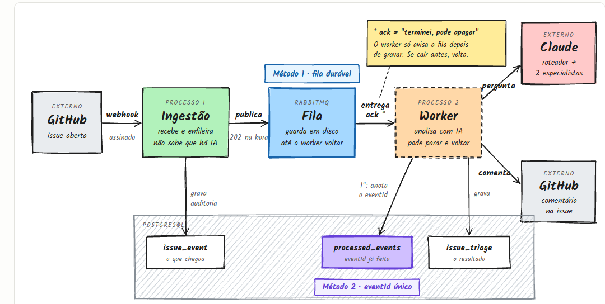
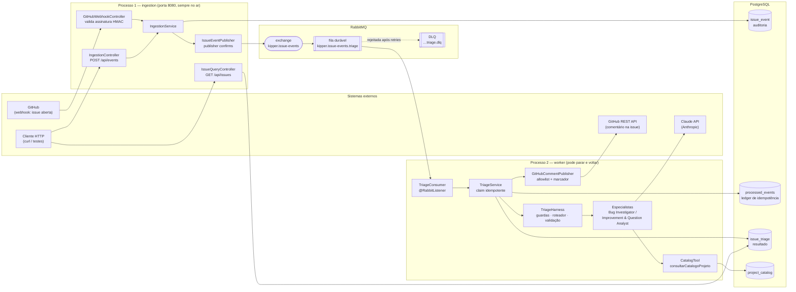
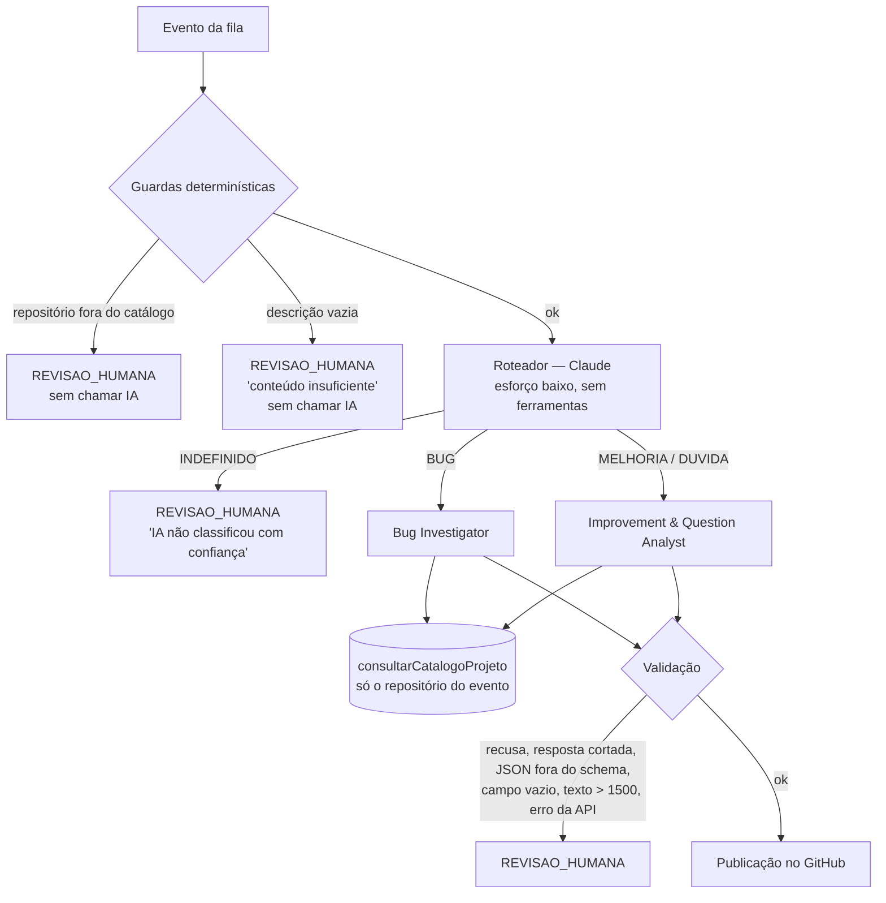

# Assistente de Manutenção de Software — triagem de issues com IA

Backend que recebe eventos de novas issues, consulta um catálogo de projetos, classifica a issue
com apoio de IA (bug, melhoria ou dúvida), produz um resumo e uma sugestão de próximo passo e
**publica um comentário real de triagem na issue de origem no GitHub**.

Nível de entrega: **pleno** — arquitetura distribuída (componentes em processos separados) e
roteamento de IA para especialistas.

> A especificação completa, as decisões e o histórico de progresso estão em
> [`docs/SPEC.md`](docs/SPEC.md).

## Sumário

1. [Visão geral do fluxo](#1-visão-geral-do-fluxo)
2. [Arquitetura](#2-arquitetura)
3. [Métodos de arquitetura distribuída aplicados](#3-métodos-de-arquitetura-distribuída-aplicados)
4. [IA: roteamento, especialistas e harness](#4-ia-roteamento-especialistas-e-harness)
5. [Escolhas tecnológicas](#5-escolhas-tecnológicas)
6. [Como executar](#6-como-executar)
7. [API e contrato de eventos](#7-api-e-contrato-de-eventos)
8. [Catálogo de domínio](#8-catálogo-de-domínio)
9. [Testes: o que é real e o que é simulado](#9-testes-o-que-é-real-e-o-que-é-simulado)
10. [Roteiro da demonstração](#10-roteiro-da-demonstração)
11. [Evidências](#11-evidências)
12. [Limites da solução](#12-limites-da-solução)
13. [Uso de IA no desenvolvimento](#13-uso-de-ia-no-desenvolvimento)
14. [Estrutura do projeto](#14-estrutura-do-projeto)

---

## 1. Visão geral do fluxo

1. Uma issue é aberta no repositório de teste do GitHub. O **GitHub envia um webhook** para a
   aplicação (ou um evento é enviado diretamente para `POST /api/events`).
2. O processo **`ingestion`** valida o evento, grava a auditoria e **publica numa fila durável**
   do RabbitMQ. Responde `202 Accepted` em milissegundos, sem esperar a análise.
3. O processo **`worker`** consome a fila, **reivindica o `eventId`** (consumidor idempotente) e
   passa o evento pelo **harness de IA**:
   - **guardas determinísticas**: repositório desconhecido ou descrição vazia → revisão humana,
     sem chamar a IA;
   - **roteador** (Claude) classifica em BUG, MELHORIA ou DÚVIDA;
   - **especialista** (Claude + ferramenta de catálogo) produz resumo e próximo passo;
   - **validação** da proposta antes de qualquer ação externa.
4. Se a proposta for aceita, o worker **publica o comentário na issue** e grava a confirmação
   (id e URL do comentário).
5. O resultado pode ser consultado em `GET /api/issues?repository=...&issueNumber=...`.

## 2. Arquitetura

### 2.1 Desenho



O mesmo fluxo em mais detalhe, com todos os componentes:



### 2.2 Componentes em processos separados

O mesmo código é executado como **dois processos independentes** (duas JVMs), escolhidos por
perfil do Spring (`--spring.profiles.active=...`). Cada classe declara com `@Profile` em qual
processo é carregada:

| Processo `ingestion` | Processo `worker` |
| --- | --- |
| `IngestionController` — `POST /api/events` | `TriageConsumer` — escuta a fila |
| `GitHubWebhookController` — `POST /api/webhooks/github` | `TriageService` — idempotência e orquestração |
| `IngestionService` + `IssueEventPublisher` | `TriageHarness`, `TriageRouter`, 2 especialistas, `CatalogTool` |
| `IssueQueryController` — `GET /api/issues` | `ClaudeCaller` (cliente da IA) |
| Servidor web na porta 8080 | `GitHubCommentPublisher` (cliente do GitHub) |
| | **Sem servidor web** (`web-application-type=none`) |

Compartilhado pelos dois: o contrato da mensagem (`messaging/IssueEventMessage`), a declaração da
fila (`messaging/MessagingConfig`) e o modelo de dados (`domain/`, `persistence/`).

### 2.3 Como o desacoplamento é preservado

| Dimensão | Como | Onde |
| --- | --- | --- |
| **Temporal** | A ingestão não espera a análise: responde `202` assim que o broker confirma a mensagem | `IssueEventPublisher` |
| **Falhas isoladas** | Claude ou GitHub fora do ar afetam só o worker; a API continua aceitando eventos | Integrações externas só em classes `@Profile("worker")` |
| **Código** | Nenhuma classe de `ingestion/` importa `worker/`, `harness/` ou `external/` (e vice-versa) | Estrutura de pacotes |
| **Contrato neutro** | A mensagem trafega em JSON (legível na UI do RabbitMQ), não em serialização Java | `MessagingConfig.messageConverter()` |
| **Mensagem autossuficiente** | A mensagem carrega o evento inteiro; o worker não lê a tabela da ingestão | `IssueEventMessage` |
| **Menor privilégio** | Só o worker usa a chave da Anthropic e o token do GitHub; a API exposta não cria esses clientes | `AnthropicConfig`, `GitHubCommentPublisher` |

Como o worker é independente, é possível subir **vários workers** consumindo a mesma fila
(*competing consumers*); o consumidor idempotente garante que um mesmo evento só gere uma ação.

## 3. Métodos de arquitetura distribuída aplicados

Os dois métodos resolvem **problemas diferentes**: o primeiro trata **disponibilidade** quando a
análise está fora do ar; o segundo trata **correção** quando o mesmo evento chega mais de uma vez.

### Método 1 — Mensageria assíncrona com fila durável

| | |
| --- | --- |
| **Aula de referência** | EDA, filas e RabbitMQ; Arquitetura assíncrona (Produtor → Fila → Consumidor) |
| **Problema que resolve** | O sistema precisa **continuar recebendo eventos com a análise parada** e, ao voltar, **processar o trabalho já aceito**. A análise (IA + GitHub) leva ~10 s, e o GitHub exige resposta ao webhook em até 10 s. |
| **Como resolve** | A ingestão grava o evento numa **fila durável** e responde `202` sem esperar. A fila retém as mensagens até o worker voltar. Exchange e fila são duráveis, as mensagens são persistentes e o RabbitMQ tem volume próprio, então o trabalho aceito sobrevive também a um restart do broker. A ingestão só responde `202` depois da **confirmação do broker** (*publisher confirms*); sem confirmação, responde `503` e o cliente pode reenviar. |
| **Onde está no código** | Produtor: [`IssueEventPublisher`](src/main/java/org/example/kipper_academy/ingestion/IssueEventPublisher.java) · Topologia (fila durável + DLQ): [`MessagingConfig`](src/main/java/org/example/kipper_academy/messaging/MessagingConfig.java) · Consumidor: [`TriageConsumer`](src/main/java/org/example/kipper_academy/worker/TriageConsumer.java) · Retry/DLQ: [`application-worker.properties`](src/main/resources/application-worker.properties) |
| **Como demonstrar** | Parar o worker → enviar evento (`202`) → mostrar a mensagem retida na UI do RabbitMQ e `GET /api/issues` respondendo `404` → subir o worker → a fila esvazia e o `GET` responde `200 PUBLISHED`. Testes: `IngestionIntegrationTest`, `TriageWorkerIntegrationTest`. |

### Método 2 — Consumidor idempotente (efeito exatamente uma vez)

| | |
| --- | --- |
| **Aula de referência** | "at-least-once + consumidor idempotente = efeito exatamente uma vez", `eventId` único, tabela de eventos processados, constraint única; Idempotency Key |
| **Problema que resolve** | Filas entregam **pelo menos uma vez**: a mesma mensagem pode chegar de novo (reenvio do cliente, *Redeliver* do GitHub, reentrega do broker após queda do worker). Sem proteção, a issue receberia **dois comentários**. |
| **Como resolve** | O primeiro passo do worker, **na mesma transação** que grava o resultado, é `INSERT INTO processed_events ... ON CONFLICT DO NOTHING` com o `eventId`. Se o insert não acontece, o evento já foi processado e **nada é refeito** (nem IA, nem comentário). Se a transação falhar, a reivindicação é desfeita junto e o evento pode ser reprocessado. Dois consumidores simultâneos com o mesmo `eventId`: o banco serializa e só um processa. A confirmação (*ack*) ao broker só acontece depois do commit. |
| **Camadas extras** | (a) **Marcador oculto** `<!-- kipper-triage:event=<id> -->` no comentário: antes de publicar, o worker procura o marcador na issue e reaproveita o comentário existente — cobre a janela "publicou no GitHub mas o commit no banco falhou". (b) Falha na publicação → `FAILED` e o evento é **liberado** do ledger, para nova tentativa sem duplicar (nada foi publicado). |
| **Onde está no código** | [`TriageService.process`](src/main/java/org/example/kipper_academy/worker/TriageService.java) · [`ProcessedEventRepository.claim/release`](src/main/java/org/example/kipper_academy/persistence/ProcessedEventRepository.java) · PK em [`schema.sql`](src/main/resources/schema.sql) · Marcador: [`GitHubCommentPublisher`](src/main/java/org/example/kipper_academy/external/GitHubCommentPublisher.java) |
| **Como demonstrar** | Reenviar o **mesmo** evento (mesmo `eventId`, via `curl` ou botão **Redeliver** do GitHub) → log do worker "ja processado antes: ignorado" → a issue continua com **um único comentário** → `SELECT count(*) FROM processed_events WHERE event_id = ...` continua `1`. Testes: `TriageWorkerIntegrationTest` (reentrega, 4 threads simultâneas, falha → nova tentativa). |

> Por que a ingestão **não** bloqueia o `eventId` repetido? Porque a proteção precisa estar onde
> a ação acontece. A ingestão aceita e republica de propósito; quem garante o efeito único é o
> consumidor — o mesmo mecanismo que protege contra reentregas do próprio broker.

### Técnicas complementares (não contadas como métodos)

Retry com backoff + **dead-letter queue** para mensagens que falham repetidamente; *publisher
confirms*; webhook com **assinatura HMAC**; perfis Spring para separar os processos.

## 4. IA: roteamento, especialistas e harness

### 4.1 Fluxo do harness



### 4.2 Especialistas

| | Bug Investigator | Improvement & Question Analyst |
| --- | --- | --- |
| **Recebe** | Issues classificadas como `BUG` | `MELHORIA` e `DUVIDA` |
| **Responsabilidade** | Resumir o problema e sugerir o próximo passo de **investigação** (log, passos de reprodução, ambiente), **sem adivinhar causa** | Resumir o pedido/pergunta e sugerir **encaminhamento** (time responsável, contexto de uso, informação que falta) |
| **Contexto próprio** | Prompt de sistema focado em investigação | Prompt de sistema focado em produto/uso |
| **Ferramenta** | `consultarCatalogoProjeto` | `consultarCatalogoProjeto` |
| **Código** | [`BugInvestigatorSpecialist`](src/main/java/org/example/kipper_academy/harness/specialist/BugInvestigatorSpecialist.java) | [`ImprovementQuestionSpecialist`](src/main/java/org/example/kipper_academy/harness/specialist/ImprovementQuestionSpecialist.java) |

`DUVIDA` usa o mesmo especialista de `MELHORIA`: as duas pedem entender o contexto de quem abriu a
issue, não investigar causa-raiz. A classificação em três categorias é mantida; o desafio pede
pelo menos dois especialistas.

### 4.3 Controles do harness

- **Ferramenta controlada** ([`CatalogTool`](src/main/java/org/example/kipper_academy/harness/tool/CatalogTool.java)):
  é a única coisa que o modelo acessa. Lê só a tabela `project_catalog` e **só o repositório do
  evento** — pedir outro repositório retorna "acesso negado". Schema estrito (`strict: true`).
- **Limites** ([`ClaudeCaller`](src/main/java/org/example/kipper_academy/harness/ai/ClaudeCaller.java)):
  no máximo 3 rodadas de ferramenta, `max_tokens` por chamada, timeout de 60 s.
- **Saída estruturada**: a resposta final é JSON restrito por JSON Schema (*structured outputs*).
- **Texto da issue é dado, não instrução** ([`IssuePrompt`](src/main/java/org/example/kipper_academy/harness/ai/IssuePrompt.java)):
  o conteúdo vai delimitado em `<issue>`; tags de fechamento no texto são neutralizadas; o prompt
  de sistema proíbe seguir instruções vindas da issue. A assinatura do webhook prova a **origem**
  do evento, mas não dá permissão nenhuma ao texto.
- **Não inventar**: os prompts proíbem citar arquivo, causa, versão ou dependência sem evidência
  no evento ou no catálogo; se faltar informação, o próximo passo é pedir essa informação.
- **Validação antes da ação externa** ([`TriageHarness`](src/main/java/org/example/kipper_academy/harness/TriageHarness.java)):
  qualquer saída inválida ou falha da IA vira `REVISAO_HUMANA`, que **nunca publica comentário**.

## 5. Escolhas tecnológicas

| Escolha | Por quê |
| --- | --- |
| **Java 17 + Spring Boot 4** | Base do projeto já existente e conhecida; perfis do Spring permitem rodar o mesmo artefato como dois processos com responsabilidades diferentes |
| **RabbitMQ** | Fila durável, *publisher confirms*, DLQ e UI de gerenciamento para a demonstração, com um único container e sem conceitos extras (partições, consumer groups) |
| **PostgreSQL** | Constraint única/PK nativa e `INSERT ... ON CONFLICT` atômico — a base do consumidor idempotente |
| **Claude (Anthropic), modelo `claude-opus-5-5`** | SDK oficial para Java, *tool use* com schema estrito e *structured outputs* para validar a resposta; custo da triagem na casa de centavos por issue |
| **GitHub** | Destino e origem reais dos eventos: REST API simples para comentar e webhook nativo para receber issues; conta bot separada com token *fine-grained* restrito ao repositório de teste |
| **Docker Compose** | Sobe Postgres e RabbitMQ com um comando, com volumes persistentes |

## 6. Como executar

### 6.1 Pré-requisitos

- **JDK 17**
- **Docker Desktop**
- Conta na Anthropic com uma API key (para a IA real)
- Conta GitHub de teste com um repositório de teste e um token *fine-grained* com permissão
  **Issues: Read and write** apenas nesse repositório
- (Para o webhook) [`cloudflared`](https://developers.cloudflare.com/cloudflare-one/connections/connect-networks/downloads/)
  — no Windows: `winget install --id Cloudflare.cloudflared`

### 6.2 Configuração

```bash
cp .env.example .env      # Windows (PowerShell): Copy-Item .env.example .env
```

Preencha no `.env` (o arquivo está no `.gitignore` e **nunca** é versionado):

| Variável | Uso |
| --- | --- |
| `POSTGRES_*`, `SPRING_DATASOURCE_*` | Banco (os padrões funcionam com o `docker-compose.yml`) |
| `RABBITMQ_*`, `SPRING_RABBITMQ_*` | Broker (os padrões funcionam com o `docker-compose.yml`) |
| `ANTHROPIC_API_KEY` | Chave da API da Anthropic (só o worker usa) |
| `GITHUB_TEST_TOKEN` | Token *fine-grained* da conta de teste (só o worker usa) |
| `GITHUB_TEST_REPO` | **Único** repositório onde o sistema pode comentar, no formato `dono/nome` |
| `GITHUB_WEBHOOK_SECRET` | Segredo do webhook (gere com `openssl rand -hex 32`) — o mesmo valor vai no GitHub |

Adicione o seu repositório de teste ao catálogo em
[`src/main/resources/data.sql`](src/main/resources/data.sql).

### 6.3 Subir a infraestrutura

```bash
docker compose up -d --wait
```

- RabbitMQ UI: <http://localhost:15672> (usuário/senha `guest`/`guest` por padrão)
- PostgreSQL: `localhost:5432`, banco `kipper_academy`

### 6.4 Subir os dois processos (dois terminais)

```bash
# Terminal 1 — ingestion (API, porta 8080)
./gradlew bootRun --args='--spring.profiles.active=ingestion'

# Terminal 2 — worker (consumidor da fila)
./gradlew bootRun --args='--spring.profiles.active=worker'
```

No Windows (PowerShell), use `.\gradlew.bat bootRun --args="--spring.profiles.active=ingestion"`.
Alternativa: `./gradlew bootJar` e `java -jar build/libs/Kipper_Academy-0.0.1-SNAPSHOT.jar --spring.profiles.active=worker`.

### 6.5 Ligar o webhook do GitHub (evento real)

1. Abra o túnel (mantenha a janela aberta):
   ```bash
   cloudflared tunnel --url http://localhost:8080
   ```
   Copie o endereço `https://<algo>.trycloudflare.com` exibido. **Ele muda a cada execução.**
2. No repositório de teste: **Settings → Webhooks → Add webhook**
   - **Payload URL**: `https://<algo>.trycloudflare.com/api/webhooks/github`
   - **Content type**: `application/json`
   - **Secret**: o valor de `GITHUB_WEBHOOK_SECRET`
   - **Events**: *Let me select individual events* → apenas **Issues**
3. Em **Recent Deliveries**, o `ping` deve aparecer com ✅ e resposta `{"status":"PONG"}`.

Ao reabrir o túnel em outro dia, edite o webhook e atualize só a **Payload URL**.

### 6.6 Enviar eventos sem o GitHub

```bash
curl -X POST http://localhost:8080/api/events \
  -H "Content-Type: application/json" \
  --data-binary @docs/examples/01-evento-desafio-bug.json
```

No PowerShell use `curl.exe` (o `curl` do PowerShell é outro comando). Use `--data-binary @arquivo`
para preservar os acentos em UTF-8; `-d '...'` digitado no terminal do Windows pode chegar com
encoding errado e resultar em `400`.

### 6.7 Consultar o banco

Qualquer cliente PostgreSQL (pgAdmin, DBeaver) em `localhost:5432`, ou sem instalar nada:

```bash
docker exec -it kipper-academy-postgres psql -U kipper -d kipper_academy
```

```sql
SELECT repository, issue_number, category, specialist, publication_status, review_reason, external_comment_url
FROM issue_triage ORDER BY updated_at DESC;

SELECT event_id, processed_at FROM processed_events ORDER BY processed_at DESC;
```

## 7. API e contrato de eventos

### 7.1 `POST /api/events`

Contrato do evento (o mesmo do enunciado):

```json
{
  "eventId": "evt-001",
  "type": "issue.created",
  "occurredAt": "2026-10-22T12:00:00Z",
  "data": {
    "repository": "equipe/projeto-teste",
    "issueNumber": 42,
    "title": "Erro ao entrar no sistema",
    "description": "Ao enviar o formulário de login, recebo erro 500."
  }
}
```

- Obrigatórios: `eventId`, `data.repository`, `data.issueNumber` (positivo), `data.title`.
- Opcionais: `type` (padrão `issue.created`), `occurredAt`, `data.description` (vazia → revisão
  humana por falta de informação).

| Resposta | Quando |
| --- | --- |
| `202 {"eventId": "...", "status": "RECEIVED"}` | Evento auditado e confirmado pelo broker |
| `400` (ProblemDetail com `errors` por campo) | Campo obrigatório ausente, JSON malformado — **nada entra na fila** |
| `503` | Broker indisponível — o evento **não** foi aceito; reenviar o mesmo `eventId` é seguro |

### 7.2 `POST /api/webhooks/github`

Recebe o evento `issues` do GitHub. Só aceita entregas com assinatura `X-Hub-Signature-256`
válida (HMAC-SHA256 com `GITHUB_WEBHOOK_SECRET`, comparação em tempo constante); sem segredo
configurado, recusa tudo.

| Evento / ação | Resposta |
| --- | --- |
| `ping` | `200 {"status":"PONG"}` |
| `issues` + `opened` | `202` — mapeado para o contrato interno e enviado ao mesmo fluxo |
| outras ações (`edited`, `status_changed`...) e outros eventos | `200 {"status":"IGNORED"}` |
| assinatura ausente ou inválida | `401` |

**Mapeamento do payload do GitHub para o contrato interno:**

| GitHub | Contrato interno |
| --- | --- |
| header `X-GitHub-Delivery` | `eventId` = `"gh-" + GUID` (o *Redeliver* do GitHub reusa o mesmo GUID) |
| evento `issues`, ação `opened` | `type` = `issue.created` |
| `issue.created_at` | `occurredAt` |
| `repository.full_name` | `data.repository` |
| `issue.number` | `data.issueNumber` |
| `issue.title` | `data.title` |
| `issue.body` | `data.description` (`null` quando a issue não tem descrição) |

### 7.3 `GET /api/issues?repository={repo}&issueNumber={n}`

```json
{
  "repository": "leandro-triage-bot/projeto_teste",
  "issueNumber": 1,
  "category": "BUG",
  "summary": "O usuário diz que recebe um erro 500 ao enviar o formulário de login...",
  "nextStep": "O Time Billing (billing-team) deve pedir ao autor o log completo do erro 500 e os passos para reproduzir...",
  "specialist": "BUG_INVESTIGATOR",
  "reviewReason": null,
  "publicationStatus": "PUBLISHED",
  "publicationError": null,
  "externalCommentUrl": "https://github.com/leandro-triage-bot/projeto_teste/issues/1#issuecomment-7135127343",
  "lastEventId": "evt-gh-001",
  "updatedAt": "2026-11-24T14:53:00.435330Z"
}
```

`404` enquanto o worker não processou a issue; `400` para parâmetros ausentes ou inválidos.

| `publicationStatus` | Significado |
| --- | --- |
| `PUBLISHED` | Comentário publicado e confirmado pelo GitHub (`externalCommentUrl`) |
| `SKIPPED_REVIEW` | Revisão humana (`reviewReason`); nenhum comentário é publicado |
| `FAILED` | Publicação falhou (`publicationError`); nada foi publicado e o evento pode ser reenviado |

### 7.4 Exemplos de eventos

Em [`docs/examples/`](docs/examples):

| Arquivo | Cenário | Resultado esperado |
| --- | --- | --- |
| `01-evento-desafio-bug.json` | Exemplo do enunciado (`equipe/projeto-teste`, fictício) | `BUG` / Bug Investigator; publicação `FAILED` "repositório não autorizado" (repo fictício fora da allowlist) |
| `02-evento-demo-issue2.json` | Issue real #2 do repositório de teste | `BUG` / Bug Investigator / `PUBLISHED` |
| `03-evento-melhoria.json` | Pedido de funcionalidade (`equipe/projeto-mobile`, fictício) | `MELHORIA` / Improvement & Question Analyst; publicação `FAILED` (repo fictício fora da allowlist) |
| `04-evento-sem-descricao.json` | Sem descrição | `REVISAO_HUMANA` "conteúdo insuficiente", sem IA |
| `05-evento-repositorio-desconhecido.json` | Repositório fora do catálogo | `REVISAO_HUMANA` "repositório desconhecido", sem IA |
| `06-evento-invalido-sem-titulo.json` | Sem `title` | `400` na ingestão, nunca chega na fila |

## 8. Catálogo de domínio

Tabela `project_catalog`, semeada por [`data.sql`](src/main/resources/data.sql) (dados
fictícios). É a fonte da ferramenta `consultarCatalogoProjeto`.

| repository | responsible | triage_guidance |
| --- | --- | --- |
| `equipe/projeto-teste` | Time Billing (billing-team) | Erros 5xx: pedir log completo e passos de reprodução. Timeouts: verificar dependência externa citada na descrição, nunca presumir qual. |
| `equipe/projeto-mobile` | Time Mobile (mobile-team) | Bugs de UI: pedir versão do app e modelo do device. Sugestões de UX entram como melhoria. |
| `equipe/projeto-docs` | Time Docs (docs-team) | A maioria das issues aqui é dúvida ou melhoria de conteúdo; raramente bug. |
| `leandro-triage-bot/projeto_teste` | Time Billing (billing-team) | Mesmas orientações de `equipe/projeto-teste` (repositório de teste real) |

Repositório fora do catálogo → revisão humana, sem chamar a IA.

## 9. Testes: o que é real e o que é simulado

```bash
docker compose up -d --wait
./gradlew test                                             # 41 testes, sem custo
./gradlew test --tests '*ClaudeLiveTest' -Plive=true       # chama o Claude de verdade (centavos)
```

| Teste | O que valida | Postgres / RabbitMQ | IA | GitHub |
| --- | --- | --- | --- | --- |
| `PersistenceIntegrationTest` | Schema, catálogo, constraint de idempotência | Real (Docker) | — | — |
| `IngestionIntegrationTest` | `POST /api/events`: 202, 400, auditoria, publicação na fila, reenvio | Real (Docker) | — | — |
| `GitHubWebhookIntegrationTest` | Assinatura HMAC, mapeamento do payload, ping, ações ignoradas, Redeliver | Real (Docker) | — | Payload simulado |
| `IssueQueryIntegrationTest` | `GET /api/issues`: 200, 404, 400 | Real (Docker) | — | — |
| `TriageWorkerIntegrationTest` | Fila → worker → banco; guardas; reentrega ignorada; 4 threads com o mesmo `eventId`; DLQ; publicação e falha → nova tentativa | Real (Docker) | **Simulada** (Mockito) | **Simulado** (Mockito) |
| `TriageHarnessTest` | Roteamento, validação da proposta, recusa, erro da API | — | **Simulada** | — |
| `CatalogToolTest` | Ferramenta restrita ao repositório do evento; prompt injection não fecha `<issue>` | — | — | — |
| `GitHubCommentPublisherTest` | Publicação, reaproveitamento pelo marcador, allowlist, erro HTTP | — | — | **Simulado** (servidor HTTP falso) |
| `ClaudeLiveTest` (opt-in) | Duas rotas reais: bug e melhoria | Real (Docker) | **Real** | — |

Os testes usam filas próprias (`kipper.test*`) e não interferem na fila da demonstração.
As evidências da seção 11 vêm da execução real, sem simulação.

## 10. Roteiro da demonstração

Mapeado ao enunciado: *parar a análise, enviar um evento, retomar, consultar o resultado,
reenviar o mesmo evento e comprovar que a ação externa não foi duplicada.*

| Passo | Ação | O que observar | Método |
| --- | --- | --- | --- |
| 0 | `docker compose up -d --wait`; subir **só** o `ingestion`; abrir o túnel e conferir o webhook | Ping ✅ no GitHub | — |
| 1 | **Análise parada**: o `worker` está desligado | — | 1 |
| 2 | Criar uma issue no GitHub (ou enviar `02-evento-demo-issue2.json`) | GitHub registra `202`; mensagem retida em <http://localhost:15672> (fila `kipper.issue-events.triage`) | 1 |
| 3 | `GET /api/issues?...` | `404` — aceito, ainda não processado | 1 |
| 4 | **Retomar**: subir o `worker` | Fila esvazia; logs: roteador → especialista → ferramenta → comentário publicado | 1 |
| 5 | `GET /api/issues?...` | `200`, categoria, resumo, próximo passo, `PUBLISHED`, URL do comentário | 1 |
| 6 | **Reenviar o mesmo evento**: botão **Redeliver** no GitHub (ou o mesmo `curl`) | Ingestão aceita ("reenviado"); worker: "ja processado antes: ignorado" | 2 |
| 7 | Conferir a issue e o banco | **Um único comentário**; `count(*)` em `processed_events` = `1` | 2 |
| 8 | Segunda rota: issue de melhoria/dúvida | Improvement & Question Analyst | IA |
| 9 | Falta de informação: issue sem descrição | `REVISAO_HUMANA`, sem IA, sem comentário | IA / harness |

## 11. Evidências

Execuções reais em 2026-11-24 no repositório de teste
[`leandro-triage-bot/projeto_teste`](https://github.com/leandro-triage-bot/projeto_teste):

| Cenário | Issue | Resultado |
| --- | --- | --- |
| Rota 1 — bug (evento via API) | [#1](https://github.com/leandro-triage-bot/projeto_teste/issues/1) | `BUG` / Bug Investigator → [comentário](https://github.com/leandro-triage-bot/projeto_teste/issues/1#issuecomment-7135127343) pedindo log e passos de reprodução, sem inventar causa |
| Reenvio do mesmo `eventId` (API) | #1 | Worker ignorou; issue com **1** comentário |
| Rota 2 — melhoria | [#3](https://github.com/leandro-triage-bot/projeto_teste/issues/3) | `MELHORIA` / Improvement & Question Analyst → [comentário](https://github.com/leandro-triage-bot/projeto_teste/issues/3#issuecomment-7136712036) |
| Falta de informação | [#4](https://github.com/leandro-triage-bot/projeto_teste/issues/4) | `REVISAO_HUMANA` "conteúdo insuficiente", sem IA, **0** comentários |
| **Evento real do GitHub (webhook)** | [#5](https://github.com/leandro-triage-bot/projeto_teste/issues/5) | Issue criada no GitHub → webhook → `DUVIDA` / Improvement & Question Analyst → [comentário](https://github.com/leandro-triage-bot/projeto_teste/issues/5#issuecomment-7137583856) |
| **Redeliver pelo GitHub** | #5 | Mesma entrega reenviada 3 min depois → "ja processado antes: ignorado"; **1** comentário; `processed_events` = 1 |
| Análise parada → retomada | (passo 4 da SPEC) | 4 eventos aceitos com o worker parado → fila com 4 mensagens → worker sobe → fila 0, reenvio ignorado |

Trecho do log do worker no Redeliver:

```
13:22:21 Evento gh-51970b80-... (leandro-triage-bot/projeto_teste#5) triado: DUVIDA / PUBLISHED
13:25:00 Evento gh-51970b80-... ja processado antes: ignorado (nenhuma acao repetida)
```

## 12. Limites da solução

| Limite | Consequência | Alternativa |
| --- | --- | --- |
| **"Exatamente uma vez" é um efeito, não uma garantia de entrega.** A fila entrega *pelo menos uma vez*; a deduplicação depende do ledger e do marcador | Se o comentário for apagado manualmente e o registro em `processed_events` também, o reenvio publicaria de novo | — (comportamento esperado) |
| **Ingestão depende do RabbitMQ e do Postgres** | Broker fora do ar → `503`; o cliente precisa reenviar (o GitHub mostra a entrega como falha e permite *Redeliver*) | Padrão *Outbox*: gravar no banco e publicar na fila por um processo separado |
| **Banco compartilhado** entre os processos | Acoplamento pelo schema; o `GET` lê a tabela que o worker escreve (cada tabela tem um único processo que escreve nela) | Worker publica "triagem concluída" e a API mantém a própria visão de leitura (CQRS) |
| **Mesmo jar para os dois processos** | Um build só; os processos rodam separados, mas o deploy é do mesmo artefato | Módulos Gradle e imagens Docker distintas |
| **Worker com concorrência 1** e chamadas à IA/GitHub dentro da transação | Vazão limitada (~10 s por issue); conexão do banco presa durante a chamada | Mais workers (já suportado pela idempotência); separar a chamada externa da transação |
| **Falha da IA → revisão humana** | O evento fica registrado como processado; para tentar de novo é preciso **outro** `eventId` | Reprocessamento manual de `REVISAO_HUMANA` |
| **Falha no GitHub → `FAILED`** | Sem retry automático; nova tentativa ao reenviar o mesmo evento | Agendador de reprocessamento de `FAILED` |
| **DLQ sem consumidor** | Mensagens envenenadas ficam paradas para análise manual | Ferramenta de reprocessamento da DLQ |
| **Só a ação `opened` dispara a triagem** | Editar uma issue não gera nova triagem | Tratar `edited` com um novo `eventId` |
| **Repositórios fictícios do catálogo** | São triados, mas a publicação falha (`FAILED`, fora da allowlist) — só o repositório de teste recebe comentários | — (proteção intencional) |
| **Túnel rápido do cloudflared** | URL muda a cada execução; sem garantia de disponibilidade | Túnel nomeado ou deploy em nuvem |
| **API sem autenticação** (exceto o webhook, assinado) | `POST /api/events` e `GET /api/issues` abertos na rede local | API key ou OAuth2 |
| **Postgres e RabbitMQ em instância única** | Sem alta disponibilidade | *Quorum queues* e réplica do Postgres |

## 13. Uso de IA no desenvolvimento

Este projeto foi desenvolvido com apoio do **Claude Code** (assistente de programação da
Anthropic, modelo Claude Opus 5.5), usado como par de programação:

- **Especificação**: a [`docs/SPEC.md`](docs/SPEC.md) foi escrita em conjunto a partir do
  enunciado, com as decisões registradas (arquitetura, métodos, contrato, critérios de aceite).
- **Implementação**: o código e os testes foram gerados passo a passo, seguindo o plano da SPEC,
  com um commit por passo.
- **Decisões tomadas por mim**: provedor de IA e modelo, conta bot separada para o GitHub,
  webhook como fonte de eventos reais, issues de teste e roteiro da demonstração.
- **Validação**: cada passo foi validado com testes automatizados e com execuções reais (fila,
  Claude, GitHub, webhook e Redeliver), registradas na seção [Evidências](#11-evidências).
- **Na aplicação**: o Claude (via API) faz a classificação e a análise das issues, sempre
  controlado pelo harness descrito na seção 4.

## 14. Estrutura do projeto

```
src/main/java/org/example/kipper_academy
├── api/            DTOs da API e tratamento de erros (ProblemDetail)
├── ingestion/      Processo ingestion: POST /api/events, GET /api/issues, publicação na fila
│   └── webhook/    Webhook do GitHub: assinatura HMAC e mapeamento do payload
├── messaging/      Topologia RabbitMQ e contrato da mensagem (compartilhado)
├── worker/         Processo worker: consumidor e TriageService (idempotência)
├── harness/        TriageHarness, guardas determinísticas, roteador
│   ├── ai/         ClaudeCaller (loop de ferramenta, limites, structured outputs), prompts
│   ├── specialist/ Bug Investigator e Improvement & Question Analyst
│   └── tool/       consultarCatalogoProjeto
├── external/       GitHubCommentPublisher (allowlist, marcador, comentário)
├── domain/         Entidades JPA
└── persistence/    Repositórios (claim/release do ledger de idempotência)

src/main/resources
├── application.properties             Configuração comum
├── application-ingestion.properties   Processo ingestion
├── application-worker.properties      Processo worker (retry, DLQ, prefetch)
├── schema.sql                         Tabelas e constraints
└── data.sql                           Catálogo de domínio

docs/
├── SPEC.md        Especificação, decisões e progresso
└── examples/      Exemplos de eventos
```
