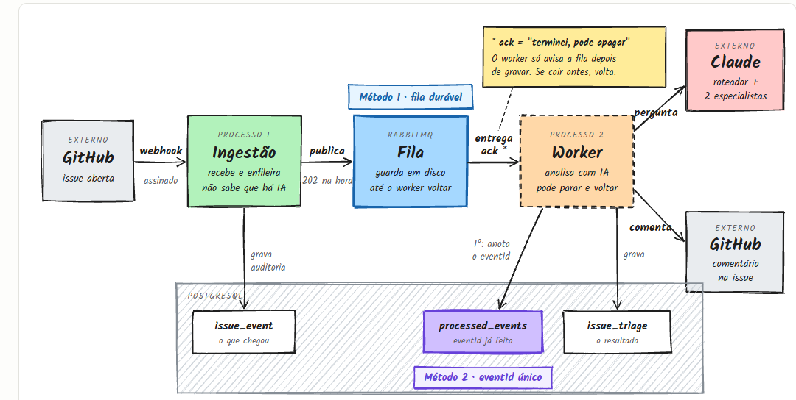

# Guia da arquitetura: como o projeto funciona por dentro

Este guia é para **entender e validar** o projeto, pasta por pasta e classe por classe.
O [README](../README.md) é a vitrine da entrega. Este documento é o mapa do código.

> **Como ler:** comece pela seção 1 (visão geral) e pela seção 2 (a vida de um evento). Depois use a
> seção 3 como consulta: cada pasta tem uma explicação do que contém, do que faz e de quem chama quem.
> A seção 6 é um roteiro para **validar com as próprias mãos** que cada parte funciona.

---

## 1. Visão geral em uma página

O sistema recebe o aviso de que uma issue foi aberta, analisa a issue com IA e publica um comentário de
triagem na própria issue do GitHub. O trabalho é dividido em **dois processos independentes**, que
conversam **só pela fila**:



O mesmo fluxo em mais detalhe:

```
   Cliente (curl)          GitHub (webhook)
        │                        │
        ▼                        ▼
┌──────────────────────────────────────────┐
│  PROCESSO 1: ingestion (porta 8080)      │   perfil Spring "ingestion"
│  - valida o evento                       │
│  - grava a auditoria (issue_event)       │
│  - publica na fila e responde 202        │
│  - GET /api/issues (consulta)            │
└───────────────┬──────────────────────────┘
                │  mensagem JSON
                ▼
┌──────────────────────────────────────────┐
│  RabbitMQ: kipper.issue-events.triage    │   fila durável (+ DLQ para falhas)
└───────────────┬──────────────────────────┘
                │  1 mensagem por vez
                ▼
┌──────────────────────────────────────────┐
│  PROCESSO 2: worker (sem porta HTTP)     │   perfil Spring "worker"
│  - idempotência (processed_events)       │
│  - harness de IA (guardas → roteador →   │
│    especialista → validação)             │──▶ API da Anthropic (Claude)
│  - publica o comentário                  │──▶ API do GitHub
│  - grava o resultado (issue_triage)      │
└──────────────────────────────────────────┘
                │
                ▼
        PostgreSQL (compartilhado pelos dois processos)
```

**Pontos-chave:**

- **É um único jar, executado duas vezes com perfis diferentes.** `--spring.profiles.active=ingestion` liga
  só as classes marcadas com `@Profile("ingestion")`. `--spring.profiles.active=worker` liga só as marcadas
  com `@Profile("worker")`. Classes sem `@Profile` (configuração, repositórios, entidades) existem nos dois.
- **A ingestão não sabe que a IA existe.** Ela só grava e enfileira. Se o worker estiver parado, as
  mensagens esperam na fila (**Método 1: mensageria assíncrona com fila durável**).
- **O worker aguenta receber a mesma mensagem duas vezes.** A tabela `processed_events` garante que cada
  `eventId` seja processado uma vez só (**Método 2: consumidor idempotente**).

### Infraestrutura (`docker-compose.yml`)

| Serviço | Para que serve | Porta | Observação |
| --- | --- | --- | --- |
| `postgres` (16-alpine) | Banco com auditoria, triagem, ledger de idempotência e catálogo | 5432 | Volume `kipper-academy-postgres-data` |
| `rabbitmq` (3.13-management) | Fila entre os processos | 5672 (AMQP), 15672 (painel web) | Volume `kipper-academy-rabbitmq-data` e hostname fixo, para as mensagens sobreviverem à recriação do container |

---

## 2. A vida de um evento, passo a passo

Exemplo: chega `POST /api/events` com `eventId = "evt-123"` para a issue `#2`.

### No processo `ingestion`

| # | O que acontece | Classe |
| --- | --- | --- |
| 1 | O JSON é convertido em `IssueEventRequest` e validado (`@NotBlank`, `@Positive`...). Se for inválido, responde **400** com a lista de erros por campo. | [`IngestionController`](../src/main/java/org/example/kipper_academy/ingestion/IngestionController.java), [`IssueEventRequest`](../src/main/java/org/example/kipper_academy/api/IssueEventRequest.java), [`ApiExceptionHandler`](../src/main/java/org/example/kipper_academy/api/ApiExceptionHandler.java) |
| 2 | Grava o evento bruto em `issue_event` com `INSERT ... ON CONFLICT DO NOTHING`. Se o `eventId` já existia, não duplica. | [`IngestionService`](../src/main/java/org/example/kipper_academy/ingestion/IngestionService.java), [`IssueEventRepository`](../src/main/java/org/example/kipper_academy/persistence/IssueEventRepository.java) |
| 3 | Publica a mensagem na exchange `kipper.issue-events` e **espera o broker confirmar** (publisher confirms). | [`IssueEventPublisher`](../src/main/java/org/example/kipper_academy/ingestion/IssueEventPublisher.java) |
| 4 | Responde **202 Accepted** com `{"eventId": "evt-123", "status": "RECEIVED"}`. Se o RabbitMQ estiver fora, responde **503** e o cliente pode reenviar. | `IngestionController`, `ApiExceptionHandler` |

> Repare: a ingestão **publica de novo** um `eventId` repetido, de propósito. Ela não esconde a reentrega.
> Quem impede a duplicação do efeito é o worker (passo 6).

### Na fila

| # | O que acontece |
| --- | --- |
| 5 | A mensagem fica em `kipper.issue-events.triage` (durável, persistente) até o worker pegá-la. Com o worker parado, você vê o contador "Ready" subir no painel do RabbitMQ. |

### No processo `worker`

| # | O que acontece | Classe |
| --- | --- | --- |
| 6 | `TriageConsumer` recebe a mensagem e chama `TriageService.process` (transação única). O **primeiro** comando é `INSERT INTO processed_events ... ON CONFLICT DO NOTHING`. Se nenhuma linha foi inserida, o evento já foi processado: registra no log "ja processado antes: ignorado" e termina. | [`TriageConsumer`](../src/main/java/org/example/kipper_academy/worker/TriageConsumer.java), [`TriageService`](../src/main/java/org/example/kipper_academy/worker/TriageService.java), [`ProcessedEventRepository`](../src/main/java/org/example/kipper_academy/persistence/ProcessedEventRepository.java) |
| 7 | **Guardas determinísticas** (código puro, sem IA): o repositório não está no catálogo ou a descrição está vazia? Então o resultado é `REVISAO_HUMANA` e a IA **não é chamada**. | [`DeterministicGuards`](../src/main/java/org/example/kipper_academy/harness/DeterministicGuards.java) |
| 8 | **Roteador** (Claude, esforço baixo, sem ferramentas): classifica como `BUG`, `MELHORIA`, `DUVIDA` ou `INDEFINIDO`. `INDEFINIDO` leva a `REVISAO_HUMANA`. | [`TriageRouter`](../src/main/java/org/example/kipper_academy/harness/TriageRouter.java) |
| 9 | **Especialista** (Claude, esforço médio, com a ferramenta de catálogo): `BUG` vai para o Bug Investigator; `MELHORIA` e `DUVIDA` vão para o Improvement & Question Analyst. Devolve `resumo` e `proximoPasso`. | [`BugInvestigatorSpecialist`](../src/main/java/org/example/kipper_academy/harness/specialist/BugInvestigatorSpecialist.java), [`ImprovementQuestionSpecialist`](../src/main/java/org/example/kipper_academy/harness/specialist/ImprovementQuestionSpecialist.java), [`CatalogTool`](../src/main/java/org/example/kipper_academy/harness/tool/CatalogTool.java) |
| 10 | **Validação** da resposta: campo vazio, texto acima de 1500 caracteres, JSON fora do schema, recusa ou erro da API levam a `REVISAO_HUMANA`. | [`TriageHarness`](../src/main/java/org/example/kipper_academy/harness/TriageHarness.java) |
| 11 | Se o resultado foi aceito, **publica o comentário** no GitHub, depois de checar a allowlist e procurar o marcador oculto do `eventId` (para não comentar duas vezes). Revisão humana não publica nada (`SKIPPED_REVIEW`). | [`GitHubCommentPublisher`](../src/main/java/org/example/kipper_academy/external/GitHubCommentPublisher.java), [`TriageComment`](../src/main/java/org/example/kipper_academy/external/TriageComment.java) |
| 12 | Grava o estado em `issue_triage` (uma linha por repositório + issue) e faz **commit**. Só então a mensagem recebe *ack* e sai da fila. | `TriageService`, [`IssueTriageRepository`](../src/main/java/org/example/kipper_academy/persistence/IssueTriageRepository.java) |

### O que acontece quando algo dá errado

| Falha | Comportamento | Por quê |
| --- | --- | --- |
| GitHub recusa ou fica fora do ar | `publication_status = FAILED`, erro gravado em `publication_error`, e o registro em `processed_events` é **liberado** (`release`) | Nada foi publicado, então reenviar o mesmo evento pode tentar de novo sem duplicar |
| Exceção inesperada (ex.: banco caiu) | A transação inteira é desfeita, inclusive o registro em `processed_events`; o Spring tenta de novo 3 vezes (1 s, 2 s) e depois manda a mensagem para a **DLQ** `kipper.issue-events.triage.dlq` | Não perde a mensagem e não fica em loop infinito |
| Worker morre no meio | Sem *ack*, o RabbitMQ reentrega a mensagem; se o commit já tinha acontecido, o passo 6 a descarta | *At-least-once* (pelo menos uma vez) + consumidor idempotente = efeito uma vez só |
| IA fora do ar ou resposta estranha | `REVISAO_HUMANA` com o motivo em `review_reason`; nenhum comentário | Nada inválido chega ao GitHub |

---

## 3. Pasta por pasta

Raiz do código: `src/main/java/org/example/kipper_academy/`.

### `KipperAcademyApplication.java`

Ponto de entrada do Spring Boot. É o mesmo `main` para os dois processos; o perfil ativo decide o que liga.

### `api/`: o contrato HTTP (DTOs e erros)

Objetos que entram e saem pela API REST. **Não contêm regra de negócio.**

| Classe | O que é |
| --- | --- |
| `IssueEventRequest` | Corpo do `POST /api/events`: `eventId`, `type` (padrão `issue.created`), `occurredAt` e `data` (repository, issueNumber, title, description). As anotações de validação definem o que é um evento válido. |
| `EventAcceptedResponse` | Resposta do 202: `eventId` + `status: RECEIVED`. |
| `IssueTriageResponse` | Resposta do `GET /api/issues`: categoria, resumo, próximo passo, especialista, motivo da revisão, status e URL do comentário, último `eventId`. |
| `ApiExceptionHandler` | Converte exceções em respostas padronizadas (*ProblemDetail*): validação → 400 com mapa `errors`; JSON ilegível → 400; issue não encontrada → 404; **RabbitMQ fora → 503**. |

### `domain/`: o modelo de dados

Entidades JPA (espelham as tabelas do `schema.sql`) e enums.

| Classe | Tabela / significado |
| --- | --- |
| `IssueEvent` | `issue_event`: auditoria do evento bruto exatamente como chegou. PK = `event_id`. |
| `IssueTriage` | `issue_triage`: estado atual da triagem de cada issue. Único por `(repository, issue_number)`. |
| `ProcessedEvent` | `processed_events`: o **ledger de idempotência**. PK = `event_id`. |
| `ProjectCatalog` | `project_catalog`: catálogo de domínio (responsável + orientação de triagem por repositório). |
| `TriageCategory` | `BUG`, `MELHORIA`, `DUVIDA`, `REVISAO_HUMANA`. |
| `Specialist` | `BUG_INVESTIGATOR`, `IMPROVEMENT_QUESTION_ANALYST`. |
| `PublicationStatus` | `PUBLISHED` (comentou), `SKIPPED_REVIEW` (revisão humana, não comenta), `FAILED` (tentou e falhou). `PENDING` existe no enum mas não é mais gravado. |

### `persistence/`: acesso ao banco

Interfaces Spring Data JPA. Os comandos que sustentam a idempotência são **SQL nativo**, para usar o
`ON CONFLICT` do PostgreSQL (o `save()` do JPA não garante isso sob concorrência).

| Classe | Métodos importantes |
| --- | --- |
| `IssueEventRepository` | `insertIfAbsent(...)`: grava a auditoria sem duplicar. Retorna 1 se inseriu e 0 se já existia. |
| `ProcessedEventRepository` | `claim(eventId, agora)`: reivindica o evento (1 = é seu, 0 = já processado). `release(eventId)`: devolve a reivindicação quando a publicação falha. |
| `IssueTriageRepository` | `findByRepositoryAndIssueNumber(...)`: usado pelo worker (para atualizar) e pelo GET (para consultar). |
| `ProjectCatalogRepository` | Busca o catálogo por repositório (usado pelas guardas e pela ferramenta da IA). |

### `messaging/`: a topologia da fila (compartilhada)

| Classe | O que faz |
| --- | --- |
| `MessagingProperties` | Lê `app.messaging.*` (nomes da exchange, fila, routing key, DLQ e timeout de confirmação). |
| `MessagingConfig` | Declara no RabbitMQ: exchange direta `kipper.issue-events`, fila durável `kipper.issue-events.triage` com *dead-letter* apontando para a DLQ, a DLQ e o binding. Também configura o conversor JSON. Os dois processos declaram a mesma topologia (é idempotente), então qualquer um pode subir primeiro. |
| `IssueEventMessage` | O **contrato da mensagem** entre os processos: `eventId, type, occurredAt, repository, issueNumber, title, description`. É a única coisa que os dois processos compartilham além do banco. |

### `ingestion/`: processo 1 (API web)

Tudo aqui tem `@Profile("ingestion")`.

| Classe | O que faz |
| --- | --- |
| `IngestionController` | `POST /api/events` → 202. |
| `IngestionService` | Grava a auditoria e publica. Ordem deliberada: **grava antes de publicar**. Se a publicação falhar, o cliente recebe 503, reenvia e o INSERT idempotente não duplica. |
| `IssueEventPublisher` | Publica usando `rabbitTemplate.invoke(...)` + `waitForConfirmsOrDie(timeout)`: só retorna depois que o broker confirmou que guardou a mensagem. |
| `IssueQueryController` | `GET /api/issues?repository=...&issueNumber=...` → estado da triagem, ou 404. |

#### `ingestion/webhook/`: entrada de eventos reais do GitHub

| Classe | O que faz |
| --- | --- |
| `GitHubWebhookController` | `POST /api/webhooks/github`. Verifica a assinatura; `ping` → `PONG`; `issues` com `action = opened` → converte e chama o **mesmo** `IngestionService`; qualquer outro evento → 200 `IGNORED` (para o GitHub não marcar como falha). |
| `GitHubSignatureVerifier` | Calcula HMAC-SHA256 do corpo com `GITHUB_WEBHOOK_SECRET` e compara com `X-Hub-Signature-256` em tempo constante. Sem segredo configurado, **recusa tudo** (*fail closed*). |
| `GitHubIssuesPayload` | Recorte do JSON do GitHub (ignora o resto) e conversão para o contrato interno. O `eventId` vira `gh-<X-GitHub-Delivery>`, então o **Redeliver** do GitHub gera o mesmo `eventId` e é deduplicado pelo worker. |

### `worker/`: processo 2 (consumidor)

Tudo aqui tem `@Profile("worker")`. O processo não abre porta HTTP (`web-application-type=none`).

| Classe | O que faz |
| --- | --- |
| `TriageConsumer` | `@RabbitListener` na fila. Só repassa para o serviço. O *ack* acontece quando o método retorna sem erro, ou seja, depois do commit. |
| `TriageService` | O orquestrador: `claim` → harness → publicar ou pular → salvar `issue_triage`. Em caso de `PublicationException`, grava `FAILED` e chama `release`. Tudo numa única `@Transactional`. |

Configuração específica em `application-worker.properties`: concorrência 1, prefetch 1, retry 3× com
backoff e `default-requeue-rejected=false` (mensagem rejeitada vai para a DLQ, não volta para a fila).

### `harness/`: a inteligência controlada

O harness decide **quando** chamar a IA, **quem** analisa e **se** a resposta é aceitável. Princípio
central: o texto da issue é **dado**, nunca instrução, e qualquer coisa fora do esperado vira `REVISAO_HUMANA`.

| Classe | O que faz |
| --- | --- |
| `TriageHarness` | Encadeia guardas → roteador → especialista → validação (`validate()`, limite de 1500 caracteres por campo). Captura `AiResponseException` e `AnthropicException` e converte em revisão humana. |
| `DeterministicGuards` | Regras sem IA: "repositorio desconhecido" (não está no catálogo) e "conteudo insuficiente" (descrição vazia). |
| `TriageRouter` | 1ª chamada ao Claude: só classifica. Esforço `LOW`, sem ferramentas, saída em JSON com schema (`categoria` + `justificativa`). |
| `TriageResult` | Resultado final do harness (categoria, resumo, próximo passo, especialista, motivo da revisão). `requiresHumanReview()` diz se publica ou não. |

#### `harness/ai/`: a conversa com a API da Anthropic

| Classe | O que faz |
| --- | --- |
| `AiProperties` | Lê `app.ai.*`: chave, modelo (`claude-opus-5-5`), timeout, máximo de rodadas de ferramenta (3). |
| `AnthropicConfig` | Cria o cliente do SDK oficial da Anthropic (só no worker), com 2 retries automáticos. |
| `ClaudeCaller` | Faz a chamada: monta a requisição com *structured output* (schema JSON), executa o **loop de ferramentas** (no máximo 3 rodadas) e trata as condições de parada. `refusal` ou `max_tokens` lançam `AiResponseException`. Também ativa o *fallback* de modelo do lado do servidor. |
| `IssuePrompt` | Monta o texto da issue dentro de `<issue>...</issue>`, neutralizando `</` para o conteúdo não "fechar" a tag. É a defesa contra *prompt injection*. |
| `AiResponseException` | Sinaliza "a IA respondeu, mas a resposta não serve". |

#### `harness/specialist/`: os especialistas

| Classe | O que faz |
| --- | --- |
| `SpecialistAgent` | Interface: `handles(categoria)`, `analyze(evento, categoria)` → `Proposal(resumo, proximoPasso)`. |
| `ClaudeSpecialist` | Base abstrata: prompt de sistema comum (inclui "nunca invente arquivo, classe, endpoint..."), esforço `MEDIUM`, schema da proposta e acesso à ferramenta de catálogo. |
| `BugInvestigatorSpecialist` | Atende `BUG`: hipótese e passo de investigação. |
| `ImprovementQuestionSpecialist` | Atende `MELHORIA` e `DUVIDA`: entende o pedido e propõe o próximo passo. |

#### `harness/tool/`: a ferramenta controlada

| Classe | O que faz |
| --- | --- |
| `CatalogTool` | Ferramenta `consultarCatalogoProjeto`. A IA pode pedir o catálogo, mas **só recebe o do repositório do evento** (`allowedRepository`), mesmo que peça outro. É somente leitura. |

### `external/`: saída para o GitHub

| Classe | O que faz |
| --- | --- |
| `GitHubProperties` | Lê `app.github.*`: token, repositório permitido, URL da API, timeout. |
| `GitHubCommentPublisher` | (1) **Allowlist**: só comenta em `GITHUB_TEST_REPO`; outro repositório resulta em `PublicationException` e `FAILED`. (2) **Marcador**: lista os comentários da issue (com paginação) procurando `<!-- kipper-triage:event=<id> -->`; se achar, reaproveita o comentário em vez de criar outro. (3) Cria o comentário via `POST /repos/{owner}/{name}/issues/{n}/comments`. |
| `TriageComment` | Monta o texto em Markdown do comentário (categoria, resumo, próximo passo, especialista) com o marcador oculto. |
| `PublicationException` | "Não foi possível publicar." Tratada pelo `TriageService`. |

### `src/main/resources/`: configuração e banco

| Arquivo | Conteúdo |
| --- | --- |
| `application.properties` | Comum aos dois processos: lê o `.env`, banco, RabbitMQ, publisher confirms, nomes da fila, IA e GitHub. |
| `application-ingestion.properties` | `server.port=8080`. |
| `application-worker.properties` | Sem servidor web; concorrência, prefetch, retry e DLQ. |
| `schema.sql` | As 4 tabelas, com as constraints que garantem a idempotência (`PRIMARY KEY event_id` e `UNIQUE (repository, issue_number)`). Roda a cada inicialização (`CREATE TABLE IF NOT EXISTS`). O Hibernate só **valida** (`ddl-auto=validate`), nunca altera. |
| `data.sql` | Catálogo: 3 repositórios fictícios + `leandro-triage-bot/projeto_teste`. |

### Outras pastas e arquivos da raiz

| Caminho | O que é |
| --- | --- |
| `docs/SPEC.md` | Especificação e plano (seção 16) com o progresso (seção 17). É a fonte das decisões. |
| `docs/examples/` | 6 eventos de exemplo em UTF-8 para usar com `curl --data-binary @arquivo`. |
| `docker-compose.yml` | PostgreSQL + RabbitMQ. |
| `.env.example` | Modelo das variáveis (copie para `.env`, que **nunca** é commitado). |
| `build.gradle` | Dependências (Spring Boot, AMQP, JPA, SDK da Anthropic) e a propriedade `-Plive=true` dos testes reais. |

---

## 4. As tabelas e o que cada uma prova

| Tabela | Quem escreve | Quem lê | O que você confirma olhando |
| --- | --- | --- | --- |
| `issue_event` | ingestion | (auditoria) | Que o evento **chegou**, mesmo que o worker esteja parado |
| `processed_events` | worker | worker | Que cada `eventId` foi processado **uma vez só** |
| `issue_triage` | worker | ingestion (GET) | O **resultado**: categoria, especialista, status da publicação, link do comentário |
| `project_catalog` | `data.sql` | guardas e ferramenta da IA | Quais repositórios o sistema conhece |

---

## 5. Mapa dos testes

Rodar: `./gradlew test --rerun` (com `JAVA_HOME` apontando para o JDK 17). Os testes usam o PostgreSQL e o
RabbitMQ do Docker, mas **filas próprias** (`kipper.test.*`) e *rollback* no banco, então não sujam os dados
da demonstração. **IA e GitHub são simulados** (mocks), exceto no teste "live".

| Teste | O que prova |
| --- | --- |
| `IngestionIntegrationTest` | 202 + mensagem na fila; campos opcionais ausentes aceitos; campo obrigatório ausente → 400 e nada publicado; JSON malformado → 400; `eventId` repetido é auditado uma vez, mas publicado de novo |
| `TriageWorkerIntegrationTest` | Repo fora do catálogo e descrição vazia → revisão humana; fluxo completo com marcador; revisão humana não publica; `FAILED` libera a reivindicação; mesmo `eventId` pela fila processado uma vez; **dois consumidores simultâneos com o mesmo `eventId`: só um processa**; mensagem inválida vai para a DLQ sem travar a fila |
| `TriageHarnessTest` | Guarda bloqueada não chama a IA; BUG → Bug Investigator; MELHORIA/DUVIDA → Analista; roteador sem confiança, campo vazio ou gigante, resposta fora do schema ou recusa, e falha de rede → `REVISAO_HUMANA` |
| `CatalogToolTest` | Devolve o catálogo do repositório do evento; nega consulta a outro repositório; nega ferramenta desconhecida; texto da issue não consegue fechar o bloco `<issue>` |
| `GitHubCommentPublisherTest` | Publica quando ainda não há comentário; reaproveita comentário existente do mesmo evento; recusa repo fora da allowlist sem chamar o GitHub; erro HTTP vira `PublicationException` |
| `IssueQueryIntegrationTest` | GET devolve a triagem publicada; revisão humana mostra o motivo; 404; parâmetro ausente ou inválido → 400 |
| `GitHubWebhookIntegrationTest` | Assinatura válida → fila com o mapeamento documentado; issue sem descrição aceita; inválida ou ausente → 401; `ping`/outras ações ignoradas; Redeliver mantém o `eventId` |
| `PersistenceIntegrationTest` | Catálogo semeado; PK impede registrar o mesmo `eventId` duas vezes; busca por repositório + número |
| `ClaudeLiveTest` | **Chama o Claude de verdade** (só com `-Plive=true`; custa alguns centavos): o bug do enunciado e um pedido de melhoria |

---

## 6. Roteiro para validar tudo com as próprias mãos

Pré-requisito: Docker Desktop aberto e `.env` preenchido.

### 6.1 Subir a infraestrutura

```bash
docker compose up -d
docker compose ps          # postgres e rabbitmq devem estar "healthy"
```

Painel do RabbitMQ: http://localhost:15672 (guest/guest). Na aba **Queues**, devem existir
`kipper.issue-events.triage` e `kipper.issue-events.triage.dlq` depois que um dos processos subir.

### 6.2 Gerar o jar e subir os dois processos (dois terminais)

```bash
./gradlew bootJar
java -jar build/libs/Kipper_Academy-0.0.1-SNAPSHOT.jar --spring.profiles.active=ingestion   # terminal 1
java -jar build/libs/Kipper_Academy-0.0.1-SNAPSHOT.jar --spring.profiles.active=worker      # terminal 2
```

### 6.3 Checklist de validação

| # | Teste | Como fazer | Resultado esperado |
| --- | --- | --- | --- |
| 1 | **Fluxo feliz** | `curl -X POST localhost:8080/api/events -H "Content-Type: application/json" --data-binary @docs/examples/02-evento-demo-issue2.json` | 202; no log do worker: roteador → especialista → "Comentario publicado"; comentário aparece na issue #2 |
| 2 | **Consulta** | `curl "localhost:8080/api/issues?repository=leandro-triage-bot/projeto_teste&issueNumber=2"` | JSON com `category`, `summary`, `publicationStatus: PUBLISHED` e `externalCommentUrl` |
| 3 | **Idempotência** (Método 2) | Repita o curl do item 1 com o mesmo arquivo | 202 de novo, mas o worker registra "ja processado antes: ignorado"; **continua 1 comentário** no GitHub |
| 4 | **Desacoplamento** (Método 1) | Pare o worker (Ctrl+C), envie um evento novo (troque o `eventId`), veja "Ready = 1" no painel do RabbitMQ e religue o worker | A ingestão respondeu 202 mesmo sem worker; ao religar, a fila volta a 0 e o evento é processado |
| 5 | **Guarda: sem descrição** | `--data-binary @docs/examples/04-evento-sem-descricao.json` | `REVISAO_HUMANA` / `SKIPPED_REVIEW`; log diz "IA NAO chamada"; nenhum comentário |
| 6 | **Guarda: repo desconhecido** | `--data-binary @docs/examples/05-evento-repositorio-desconhecido.json` | `REVISAO_HUMANA` com motivo "repositorio desconhecido" |
| 7 | **Validação da entrada** | `--data-binary @docs/examples/06-evento-invalido-sem-titulo.json` | **400** com `errors` apontando o campo; nada entra na fila |
| 8 | **Broker fora** | `docker compose stop rabbitmq` e envie um evento | **503**; depois `docker compose start rabbitmq` |
| 9 | **Webhook real** | Com o túnel `cloudflared` ativo e a URL cadastrada no GitHub, abra uma issue no repositório de teste | Comentário automático na issue; `eventId` começa com `gh-` |
| 10 | **Redeliver** | GitHub → Settings → Webhooks → Recent Deliveries → **Redeliver** | Worker ignora (mesmo `gh-<delivery>`); continua 1 comentário |

### 6.4 Consultas SQL úteis (pgAdmin ou `docker exec`)

Via terminal: `docker exec -it kipper-academy-postgres psql -U kipper -d kipper_academy`

```sql
-- O que chegou (auditoria da ingestão)
SELECT event_id, repository, issue_number, title, received_at
FROM issue_event ORDER BY received_at DESC;

-- O que foi processado (1 linha por eventId: prova da idempotência)
SELECT event_id, processed_at FROM processed_events ORDER BY processed_at DESC;

-- O resultado da triagem por issue
SELECT repository, issue_number, category, specialist, publication_status,
       review_reason, publication_error, external_comment_url, last_event_id
FROM issue_triage ORDER BY updated_at DESC;

-- Eventos que chegaram mas ainda não foram processados (ex.: worker parado)
SELECT e.event_id, e.repository, e.issue_number
FROM issue_event e LEFT JOIN processed_events p ON p.event_id = e.event_id
WHERE p.event_id IS NULL;

-- Catálogo conhecido
SELECT repository, responsible FROM project_catalog;
```

> A última consulta "não processados" também lista eventos que terminaram em `FAILED` (a reivindicação
> foi liberada de propósito) e os que foram para a DLQ.

### 6.5 O que olhar nos logs

| Mensagem no log | Significado |
| --- | --- |
| `Evento X (...) aceito e publicado na fila` | Ingestão OK, primeira vez |
| `Evento X reenviado: ja estava auditado...` | Mesmo `eventId` chegou de novo na ingestão |
| `guarda deterministica -> REVISAO_HUMANA (...); IA NAO chamada` | Bloqueado antes da IA |
| `roteador -> BUG (...)` | Classificação do roteador |
| `... aceito pelo harness` | Proposta do especialista passou na validação |
| `Comentario publicado em repo#n: <url>` | Comentário criado no GitHub |
| `ja processado antes: ignorado` | **Idempotência funcionando** |
| `publicacao falhou (...); reivindicacao liberada` | `FAILED`, pode ser reenviado |
| `Webhook ... ignorado: acao edited nao dispara triagem` | Evento do GitHub que não interessa |

---

## 7. Onde mexer para mudar algo

| Quero... | Arquivo |
| --- | --- |
| Adicionar um repositório ao catálogo | `src/main/resources/data.sql` |
| Mudar o modelo da IA ou o timeout | `application.properties` (`app.ai.*`) |
| Mudar o prompt de um especialista | `BugInvestigatorSpecialist` / `ImprovementQuestionSpecialist` (e a base `ClaudeSpecialist`) |
| Mudar o prompt de classificação | `TriageRouter` |
| Adicionar uma regra sem IA | `DeterministicGuards` |
| Mudar o texto do comentário | `TriageComment` |
| Mudar retry / concorrência do worker | `application-worker.properties` |
| Permitir comentar em outro repositório | `GITHUB_TEST_REPO` no `.env` (e o token precisa ter acesso) |
| Reagir a outra ação do GitHub (ex.: `edited`) | `GitHubWebhookController` / `GitHubIssuesPayload` |
